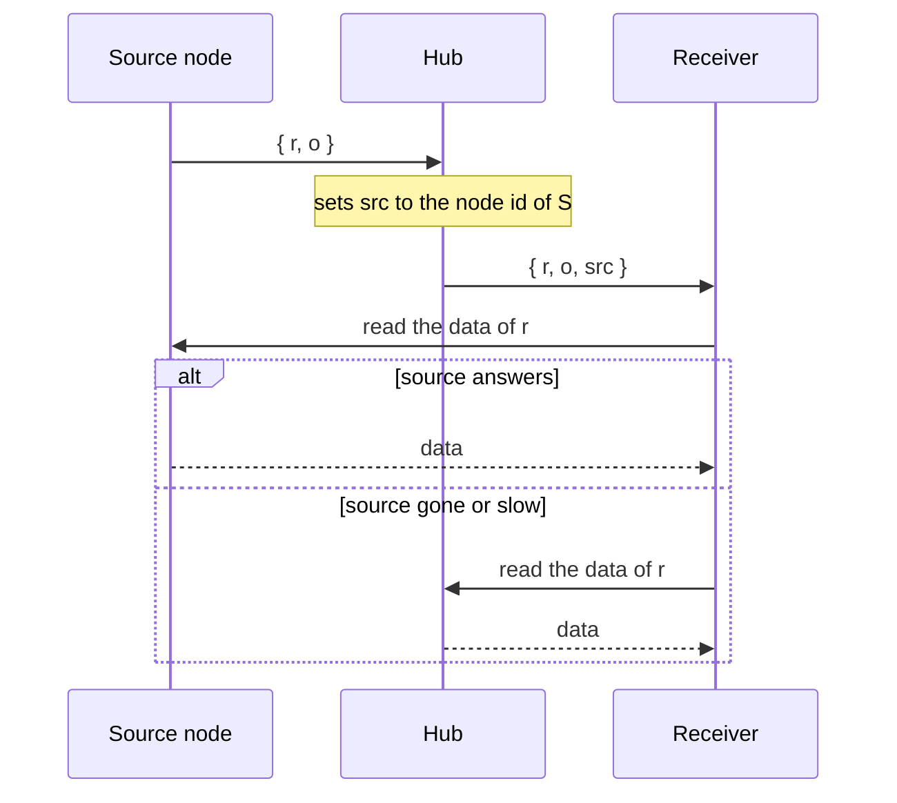

<!--
@license
Copyright (c) rljson

Use of this source code is governed by terms that can be
found in the LICENSE file in the root of this package.
-->

# `ConnectorPayload` names its source

## Motivation

- A hub relays every new ref to its receivers as a `ConnectorPayload`. The
  payload says which ref is new, but not which node holds the data behind it.
- So a receiver can only ask the hub for the data, and the hub has to fetch
  it from the sender first. Every byte passes the hub, and the hub becomes
  the bottleneck.
- The node that just wrote the data is the natural first place to ask. The
  wire type has to say which node that is.
- The existing fields do not fit: `o` is an ephemeral origin for the
  self-echo filter, and `c` is an id the sender picks for itself. Neither is
  a node another node can reach.

## Strategy

- Add one optional field to `ConnectorPayload`: `src`, the node a relayed
  ref came from.
- The hub fills it, not the sender. It knows which connection delivered the
  ref and which node that connection said it is.
- A value a sender puts there itself is not trusted: the hub overwrites it,
  and leaves the field out when it does not know the sending node.
- `src` is a hint, not a promise. A receiver may ask the source first; the
  hub can always serve the data.
- The field is optional, so old payloads stay valid and old receivers ignore
  it. Like `stamp`, it is something a hub adds while relaying.

## Implementation: the `src` field

- `ConnectorPayload` in `src/sync/connector-payload.ts` gains
  `src?: string`, the node id of the source.
- Its TSDoc says who sets it, when the hub leaves it out, and that the node
  may be gone or unreachable.
- The field table in the type's doc comment gains the row "Source node".
- `connectorPayloadFullExample()` carries `src: 'node_ExAmPlE'`.
- Tests check that the minimal example has no `src`, that the full example
  has it, and that a payload with only `o`, `r` and `src` is valid.

## Implementation: documentation

- `README.public.md`: the example of an enriched payload shows `src`, and a
  short paragraph explains who sets it and that it is a hint.
- `README.architecture.md`: the field table of `ConnectorPayload` gains the
  `src` row, with a note that the relaying hub sets it, never the sender.
- `index.jsonc` is new: a short overview of the repo, its domain and its
  interfaces. It lists the sync wire types, `src` among them.

## Open Points

- This repo only defines the field. Setting it on the hub and reading from
  the source happen in the code that relays and reads refs.
- `src` is a plain `string`. Unlike `ClientId`, there is no type, generator
  or check for a node id yet.
- The hub knows the node id only from what the sending connection told it. A
  wrong id costs a receiver one failed read, then it asks the hub.
- `src` names the node the relaying hub got the ref from. When a ref passes
  several hubs, each one sets it anew: it names the hop before at best, not
  necessarily the node that wrote the data.
