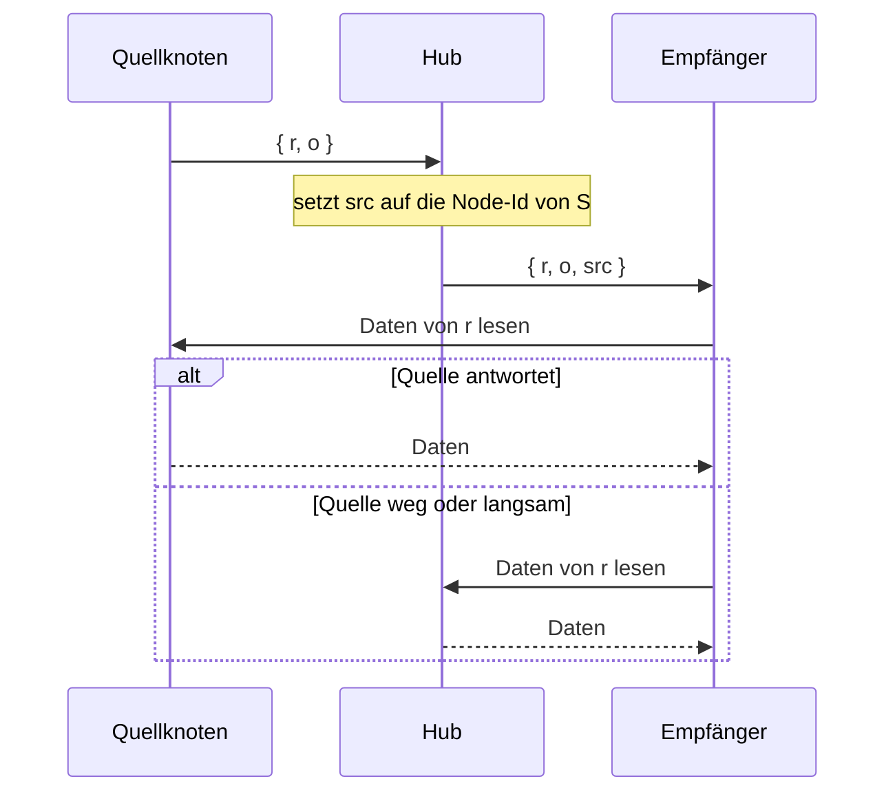

<!--
@license
Copyright (c) rljson

Use of this source code is governed by terms that can be
found in the LICENSE file in the root of this package.
-->

# `ConnectorPayload` nennt seine Quelle

## Motivation

- Ein Hub leitet jede neue Ref als `ConnectorPayload` an seine Empfänger
  weiter. Das Payload sagt, welche Ref neu ist, aber nicht, welcher Knoten
  die Daten dahinter hat.
- Ein Empfänger kann die Daten deshalb nur beim Hub anfragen, und der Hub
  muss sie zuerst beim Sender holen. Jedes Byte läuft über den Hub, und der
  Hub wird zum Engpass.
- Der Knoten, der die Daten gerade geschrieben hat, ist die naheliegende
  erste Adresse. Dafür muss der Wire-Typ sagen, welcher Knoten das ist.
- Die vorhandenen Felder passen nicht: `o` ist ein flüchtiger Ursprung für
  den Self-Echo-Filter, `c` eine Id, die sich der Sender selbst aussucht.
  Keins von beiden ist ein Knoten, den ein anderer Knoten erreichen kann.

## Strategie

- Ein neues optionales Feld in `ConnectorPayload`: `src`, der Knoten, von
  dem eine weitergeleitete Ref kam.
- Der Hub füllt es, nicht der Sender. Er weiß, über welche Verbindung die
  Ref kam und welchen Knoten diese Verbindung ihm genannt hat.
- Einem Wert, den ein Sender selbst einträgt, wird nicht vertraut: Der Hub
  überschreibt ihn und lässt das Feld weg, wenn er den Sender nicht kennt.
- `src` ist ein Hinweis, kein Versprechen. Ein Empfänger darf zuerst die
  Quelle fragen; der Hub kann die Daten immer liefern.
- Das Feld ist optional: Alte Payloads bleiben gültig, alte Empfänger
  ignorieren es. Wie `stamp` ergänzt es der Hub beim Weiterleiten.

## Realisierung: das Feld `src`

- `ConnectorPayload` in `src/sync/connector-payload.ts` bekommt
  `src?: string`, die Node-Id der Quelle.
- Die TSDoc sagt, wer es setzt, wann der Hub es weglässt und dass der Knoten
  weg oder unerreichbar sein kann.
- Die Feldtabelle im Doc-Kommentar des Typs bekommt die Zeile „Source node“.
- `connectorPayloadFullExample()` enthält `src: 'node_ExAmPlE'`.
- Tests prüfen, dass das minimale Beispiel kein `src` hat, das volle
  Beispiel schon, und dass ein Payload nur mit `o`, `r` und `src` gültig ist.

## Realisierung: Dokumentation

- `README.public.md`: Das Beispiel eines angereicherten Payloads zeigt
  `src`, ein kurzer Absatz erklärt, wer es setzt und dass es ein Hinweis ist.
- `README.architecture.md`: Die Feldtabelle von `ConnectorPayload` bekommt
  die Zeile `src`, mit dem Vermerk, dass der weiterleitende Hub es setzt,
  nie der Sender.
- `index.jsonc` ist neu: ein kurzer Überblick über das Repo, seine Domäne
  und seine Schnittstellen. Er nennt die Sync-Wire-Typen, darunter `src`.

## Offene Punkte

- Dieses Repo definiert nur das Feld. Das Setzen im Hub und das Lesen bei
  der Quelle passieren im Code, der Refs weiterleitet und liest.
- `src` ist ein einfacher `string`. Anders als für `ClientId` gibt es noch
  keinen Typ, Generator oder Check für eine Node-Id.
- Der Hub kennt die Node-Id nur aus dem, was ihm die sendende Verbindung
  gesagt hat. Eine falsche Id kostet einen Empfänger einen Fehlversuch,
  danach fragt er den Hub.
- `src` nennt den Knoten, von dem der weiterleitende Hub die Ref bekam.
  Läuft eine Ref über mehrere Hubs, setzt jeder es neu: Es nennt bestenfalls
  den Hop davor, nicht unbedingt den Knoten, der die Daten geschrieben hat.
